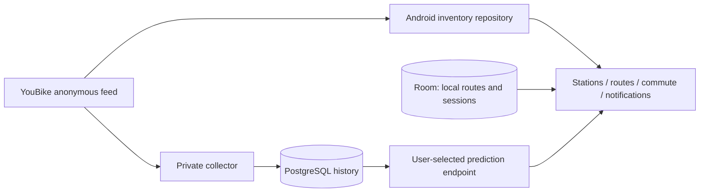

# Architecture

## Current boundaries — 2026-10-21

Android works without a prediction backend. Station metadata and current counts come directly from YouBike. Local routes, thresholds, backups, schedules, notifications and commute session state remain on the phone. Predictions are optional and do not replace the current inventory reading. Unflagged notification inventory expires before becoming stale, including when predictions are disabled.

`BluetoothBorrowService` in `core:platform` observes new ACL connections while a user-started commute awaits borrowing. The resumed activity handles Bluetooth permission and foreground-service startup; the application provides the local session repository without initializing UI adapters. `YouBikeBorrowDetection` in `core:domain` implements the chosen rule: a cached name starting with `EYB` immediately produces the ordinary ConfirmBorrowed command, independent of bike type. Room applies it only to the target session ID and revision. There is no scan, GATT client, already-connected snapshot trigger, or disconnect-to-return rule. The nonsticky service stops after borrowing/cancellation, task removal, Bluetooth off or session replacement; foreground reentry can resume a pending commute. Manual controls remain available. Debug field capture is independent of this service.

The backend exposes one product capability: future inventory predictions. There are no public station, coverage, installation, account, device or route endpoints. Health checks support deployment operations. The collector and history database are private implementation details of prediction.

## Android

- `core:model`: immutable inventory, route, forecast and prediction-configuration values.
- `core:domain`: repository ports, freshness, reminder rules and commute reducer.
- `core:data`: anonymous YouBike inventory adapter and interchangeable prediction HTTP adapter.
- `core:database`: Room route/session persistence.
- `core:platform`: notifications, WorkManager and platform capability adapters.
- `core:map`: shared Google Maps Compose view, clustered station markers and current-inventory projection.
- Feature modules own browsing, route authoring and commute presentation.
- `app` composes adapters and owns the full-page prediction settings UI and Keystore-backed API-key persistence.

One shared YouBike adapter serves coverage, search, details and reminders. Batch inventory reads classify only the requested stations; sorted metadata and region indexes are built once per accepted feed. Visible station and commute screens refresh every three seconds while their lifecycle is STARTED, skip overlapping requests, honor upstream Retry-After, and stop scheduling ticks when hidden. Updates retain the last rows, preview, geometry and camera; search and pagination are independent from inventory refresh. Native marker identities depend on station identity, not counts or the displayed metric. Ordinary reads use the official area catalog and nationwide feed, gzip, ETag/Last-Modified and a mutex-protected one-minute in-memory cache. Explicit refresh fetches the nationwide feed once with `Cache-Control: no-cache` and without conditional validators, then browsing, selected stations and map backups read that accepted snapshot. It bypasses the local TTL but still honors mobile 429 Retry-After. A device-clock rollback also expires the local TTL. Area metadata refreshes daily or when a new area appears. A complete response is validated before replacing the accepted snapshot. A normal 304 preserves source/fetched timestamps; freshness is recomputed from source time when serving cached readings. Failed refreshes report an error and preserve the accepted snapshot, rather than displaying old counts as a successful update. Pending commute refreshes are cancelled when their session ends or is replaced.

Search and paging happen locally over the accepted catalog. No user search, route name or installation credential is sent to a YouCommuter station server. The cache is process-local; restarting the app downloads inventory again. Persistent offline inventory caching is not implemented.

## Maps

Android uses Google Maps Compose 8.3.1, with the standard Maps SDK for Android and traditional custom markers. No Map ID, cloud styling, Places, Street View, routing or tile-server API is configured. Google currently lists the Maps SDK SKU as unlimited/no charge; map loads with a Map ID instead trigger Dynamic Maps. A Google Cloud project with billing enabled, Maps SDK for Android enabled and a valid app key is still required. See [SKU triggers](https://developers.google.com/maps/billing-and-pricing/sku-details#maps-sdk), [pricing](https://developers.google.com/maps/billing-and-pricing/pricing) and [setup](https://developers.google.com/maps/documentation/android-sdk/get-api-key).

The build injects the client key through manifest metadata. Set it through the scoped Gradle property/environment variable or ignored local.properties file; never embed an unrelated third-party key. Restrict the key to Maps SDK for Android and the authorized Android package/signing SHA-1. Google Maps Compose owns native lifecycle, saved camera state and attribution. No bulk/offline download is offered. Without a configured key, the map shows a concise unavailable state while list views and inventory remain usable. Real basemap authentication/rendering must be verified with an authorized key before release.

Station browsing and route selection default to maps and retain a list switch. Browsing consumes every matching local inventory page and rejects repeating cursors. Route selection instead reads a complete, sorted `StationLocation` catalog in one repository call; it contains only identity, name, address, region and coordinates. The catalog is projected once per accepted feed and can reuse that snapshot for a day without fetching live inventory. Normal inventory reads retain their one-minute freshness policy. Route picker lists and previews show names and addresses without availability counts or freshness warnings; a map preview requires an explicit Select action. Backup pickers resolve the primary location first, start in its region at street zoom, and retain a purple, non-selectable primary pin even when searching. Existing backups remain excluded. Switching region stops following the primary camera.

Maps cluster dense stations with a native `DefaultClusterRenderer`. Location-only maps use simple pins. Inventory maps share bounded, cached bitmap icons by metric, count and selection; they retain bike/dock icons, numeric counts, theme colors and font scaling. No asynchronous cluster task creates or measures a Compose view, so leaving a map during loading cannot access a detached Compose saved-state owner. The selected location is a separate native overlay; preview changes do not rebuild the location clusters. Inventory refreshes update visible icons directly; they do not clear cluster items or recreate selected markers. Borrow inventory markers use the route’s displayed bike kind (total when both kinds are displayed); return markers use destination docks. Unknown, non-operating or non-fresh readings have no usable numeric marker. Station browsing previews retain warnings and subtype counts. Details are inline cards rather than modal dialogs.

The active commute map shows only the borrowing group before borrowing and only the returning group afterward. It is a static overview without controls or map gestures, so vertical drags scroll the page. Each saved station keeps a count marker at its actual coordinate; the camera fits only the active group. All saved stations remain listed below, with fixed-width, right-aligned count groups and truncated names. Icons sit 4dp from their values, with 16dp between groups; count changes do not move the columns. The first station above the configured threshold is emphasized; if none is sufficient, the first positive count is emphasized. Healthy counts use a contrast-safe green, low counts orange, empty counts the error color and unknown readings a neutral color. Recommendations never change the selected station automatically. Return availability stays visible before borrowing.

Maps use the SDK foreground location component when coarse or fine permission is granted. An explicit locate action requests permission and a cancellable current fix; denial does not block station selection. No background location permission or continuous application-level location polling is requested. The SDK owns ongoing blue-dot updates and map lifecycle. GPS nearby search, road routing and persistent offline inventory are not implemented.

Routes can be duplicated into a new draft and borrowing/returning groups can be swapped, including ordered backups. Bike display uses two icon toggles with at least one enabled. When both kinds are enabled, a separate dropdown chooses total, regular or electric counts for shortage thresholds. A single displayed kind implicitly supplies the threshold metric. These preferences persist with routes and session snapshots and are propagated to reminder selection and forecast metrics. Stored route/session payloads require all current fields, including explicit selected stations. Reminder jobs store only route ID, revision and departure time; the worker reads the current saved route and skips deleted or changed routes.

## Navigation and appearance

Top-level tabs crossfade in 180ms. Settings and the route list/editor/picker hierarchy use a 220ms shared-axis transition, reversing direction on return. Content keys identify pages rather than form values or inventory, so data updates do not replay navigation. Outgoing page snapshots survive until their transition finishes; only the active page handles Back. Saved state retains tab scroll positions, editor position and map camera state. Compose motion follows the system animator duration scale.

Android 10 remains the minimum supported OS. Android 12+ uses the system Material You color scheme in light and dark mode. Notification accent, content colors and borrowing/returning card colors reference the corresponding system palette resources. Earlier Android versions retain the existing fallback palette. Availability colors remain semantic (green sufficient, orange low, red empty), independently of the theme accent.

## Prediction configuration

The endpoint is a complete URL, including the prediction path. Empty means predictions are disabled. Production accepts HTTPS without embedded credentials, fragment or query parameters. Debug additionally accepts local emulator/loopback HTTP. API keys are optional bearer credentials encrypted with Android Keystore; app data is excluded from Android backup.

Saving a different configuration advances a persisted revision. In-flight results from an older revision are discarded. Previously posted departure notifications are cleared and future reminder work reads the new configuration. Posting and configuration changes share a revision guard, preventing an old provider from reposting an estimate after the change. No prediction cache or station cache is shared across service credentials.

Connection testing sends a fixed public station and a synthetic arrival, not a saved user route. It validates the actual forecast response contract. No registration step or discovery endpoint is required.

## Portable station identity

Station IDs use `youbike:<station_no>`. A prediction response includes `stationVersion`, a deterministic fingerprint of capacity, system and coordinates. Android computes the same value from the official feed. It rejects predictions for mismatched metadata, expired observations or another arrival/metric.

Database station epochs remain private and isolate model history after a capacity/system change or relocation over 50 m. Independent services never need to coordinate epoch IDs. The shared `fixtures/station-version.json` verifies cross-language fingerprints; details are in [the protocol](PREDICTION_PROTOCOL.md).

## Prediction backend

Compose runs `/server` and `/collect` from one Go image after `/initdb`. The initializer applies one embedded schema in a transaction and checks its checksum on repeated runs. A mismatched schema requires rebuilding the database; no migration history or data conversion is maintained. `/server` exposes the prediction batch and health endpoints. `PREDICTION_API_KEY` optionally protects predictions; absent keys enable public operation. A bounded per-process source-IP limiter restricts prediction batches. Forwarded client-IP headers are not trusted automatically; public reverse proxies should apply their own rate limits.

The collector downloads one nationwide YouBike snapshot per minute. All area, catalog, epoch, inventory/history and validator updates commit in one transaction. A session advisory lock permits one collector. Retry state survives restarts, 429 honors Retry-After, malformed bodies preserve accepted data, and 304 creates no observations. Collector health is independent of API database readiness.

Raw history retains at least 90 days until canonical compact series exist. `feed_snapshot` describes provider inventory-snapshot time, not a bike-controller or rental event. Missing source time remains `provider_only` and is excluded from forecasts. The experimental estimator preserves cold-start/unavailable states, has no calibrated shortage probabilities, and supports total, regular, electric bikes and return docks. Route preferences choose total, regular or electric bikes for UI thresholds, reminders and forecast comparisons.

## Deployment and Cloudflare

The implemented runtime is Go + PostgreSQL/PostGIS on Docker Compose. The protocol does not require that runtime or deployment provider.

A Workers implementation remains a later deployment slice. It must preserve the same wire contract, timestamp/metadata semantics and algorithm conformance. Workers’ scheduled-event and memory/CPU limits require measured ingestion/inference benchmarks. Compact history/model artifacts in R2 are preferable to copying the current per-observation SQL history into D1. A full Cloudflare deployment also needs a collection/aggregation/storage design; moving an HTTP gateway alone does not move the prediction workload.

Cloudflare references: [runtime languages](https://developers.cloudflare.com/workers/languages/), [limits](https://developers.cloudflare.com/workers/platform/limits/), [Cron Triggers](https://developers.cloudflare.com/workers/configuration/cron-triggers/), [D1 limits](https://developers.cloudflare.com/d1/platform/limits/).
